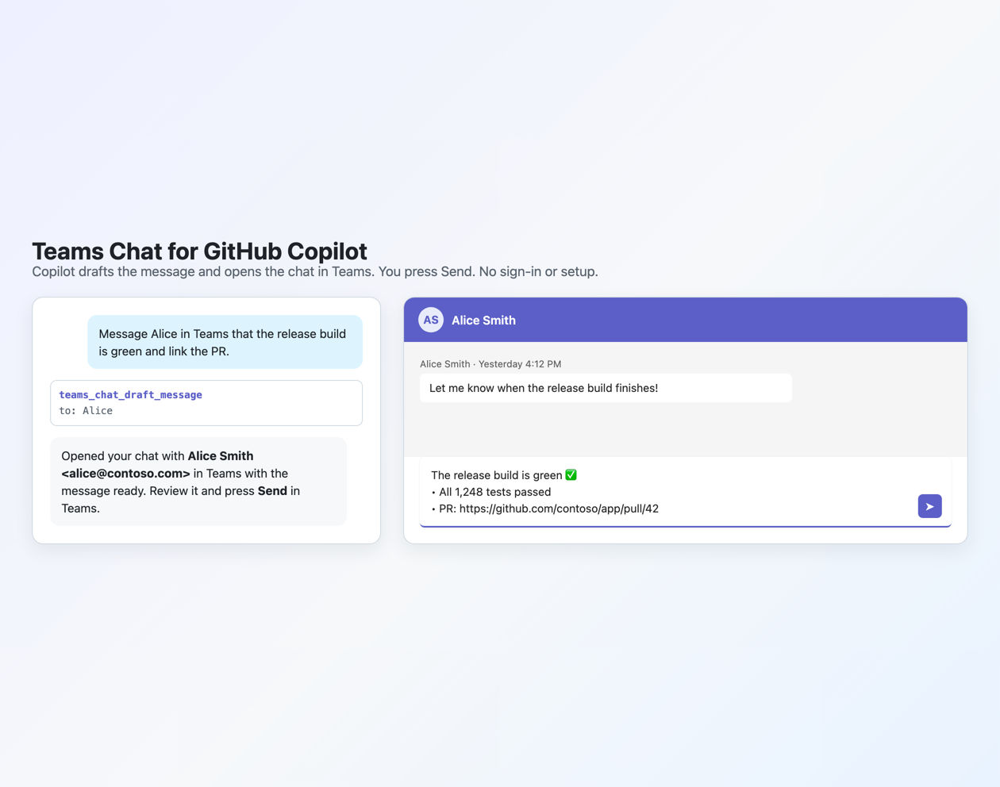

# Teams Chat for GitHub Copilot

Send Microsoft Teams messages from your GitHub Copilot chats.

Ask Copilot things like "message alice@contoso.com in Teams that the deploy finished" or "post the release notes to the team chat". Copilot writes the message, shows you exactly what will be sent and to whom, and sends it only after you confirm.



## How it works

Messages go through **Teams workflows** (Power Automate) that you create once. There's no separate Microsoft sign-in and no app registration, so it works even in organizations that require admin approval for third-party apps. There are two kinds:

| | Send to anyone (`direct`) | Fixed chat (`chat`) |
| --- | --- | --- |
| Who it reaches | Any person in your organization, by email. One person gets your 1:1 chat; several get a new group chat. | The one chat or channel the workflow was set up for |
| Appears from | You | The Workflows bot |
| Setup | Build one workflow (about 5 minutes), see [Send to anyone](#send-to-anyone) | Use a built-in template, see [Post to a fixed chat](#post-to-a-fixed-chat) |

## Features

- **Confirmation before every send.** You see the destination and the full message, and nothing is posted until you approve it. If the draft changes after you confirm, you're asked again.
- **Markdown formatting.** Bold, italics, links, lists, headings, and code blocks. Messages are sent as Adaptive Cards.
- **Message people by email or name.** "Send to Alice" works once Copilot knows Alice's address (save it as a contact). Copilot never guesses an address from a name.
- **Named fixed chats.** Save as many fixed-chat workflows as you like ("team chat", "release channel") and pick one per message.
- **Compose canvas.** A side panel where Copilot fills in a draft and you edit it, preview it, and click Send. Copilot cannot send from the canvas; only your click does.
- **No dependencies.** Plain Node.js built-ins.

## Install

In the GitHub Copilot app or CLI:

```sh
copilot plugin install kachawla/copilot-teams-chat
```

Once listed on [awesome-copilot](https://github.com/github/awesome-copilot):

```sh
copilot plugin install teams-chat@awesome-copilot
```

Requires Node.js 22 or later, and Teams with the Workflows app available (it is by default in Microsoft 365).

## Send to anyone

This workflow takes a list of email addresses and a message, opens (or creates) the chat with those people, and posts the message as you. Build it once.

1. Start from the same template as a fixed chat: in Teams, open **Apps > Workflows** (or go to [make.powerautomate.com](https://make.powerautomate.com) > **Templates**) and create **Send webhook alerts to a chat**. Pick any chat; it won't be used. Name it something like "Copilot direct messages".
2. Open it for editing in Power Automate: [make.powerautomate.com](https://make.powerautomate.com) > **My flows** > the workflow > **Edit**.
3. Keep the trigger, **When a Teams webhook request is received**. Delete every step after it.
4. Add the action **Microsoft Teams > Create a chat**:
   - **Members to add**: the expression `triggerBody()?['to']`
   - **Title**: the expression `triggerBody()?['topic']` (only used for group chats)
5. Add the action **Microsoft Teams > Post message in a chat or channel**:
   - **Post as**: **User**
   - **Post in**: **Group chat** (this is correct for 1:1 chats too)
   - **Group chat**: choose **Enter custom value**, then pick **Conversation ID** from **Create a chat** (or the expression `body('Create_a_chat')?['id']`)
   - **Message**: the expression `triggerBody()?['html']`
6. **Save**. Open the trigger step and copy its URL.
7. In Copilot, say "Save this as my direct Teams workflow: <URL>". Copilot asks you to confirm.

Then just ask: "Message alice@contoso.com in Teams: can you review my PR?" To use names, tell Copilot once: "Save Alice as alice@contoso.com in Teams contacts."

What the extension sends to the workflow:

```json
{
  "to": "alice@contoso.com;bob@contoso.com",
  "topic": "Release sync",
  "html": "<p>Build is <strong>green</strong></p>",
  "text": "Build is **green**"
}
```

`topic` is only set when there are several people. `text` is the original Markdown, in case you'd rather post that.

Things to know:
- Each message to several people creates a **new** group chat, because Teams doesn't look up existing group chats by their members. For an ongoing group, use a fixed-chat workflow for that chat instead.
- The extension only learns that the workflow accepted the request. If a message doesn't arrive (for example, a mistyped address), the workflow's **run history** in Power Automate shows the error.
- This workflow can message anyone in your organization as you, so its URL is as sensitive as a password. See [Privacy and security](#privacy-and-security).

## Post to a fixed chat

Do this once for each chat or channel you want to post to.

1. Create the workflow, either way:
   - In Teams, open **Apps**, search for **Workflows**, and open it. Choose **Create**, then search the templates for **webhook**.
   - Or go to [make.powerautomate.com](https://make.powerautomate.com) and open **Templates**.
2. Pick **Send webhook alerts to a chat** (or **Send webhook alerts to a channel**).
3. Name it, sign in to the Teams connection if asked, and choose where to post.
4. Copy the webhook URL it shows at the end. In Power Automate, it's also on the workflow's first step, **When a Teams webhook request is received**.
5. In Copilot, say "Save this Teams workflow as team chat: <URL>". Copilot asks you to confirm before saving it.

**Posting to just yourself:** to try it out without bothering anyone, post to a private team with only you in it, using the channel template. Or edit the workflow's **Post card in a chat or channel** step and set **Post in** to **Chat with Flow bot**; messages then land in your own chat with the Workflows app.

## Use

- "Message alice@contoso.com in Teams: the deploy finished."
- "Send Alice and Bob a summary of this PR review in Teams, and call the chat Release review."
- "Save Bob as bob@contoso.com in my Teams contacts."
- "Post to team chat in Teams: the deploy finished."
- "Open a Teams draft for team chat so I can edit it before sending."
- "Which Teams workflows do I have saved?"

### Tools

| Tool | What it does |
| --- | --- |
| `teams_chat_send_message` | Sends a message after you confirm it: to people (`to`) through the send-to-anyone workflow, or to a fixed chat. |
| `teams_chat_add_webhook` | Saves a workflow URL under a name, as `direct` or `chat`, after you confirm it. |
| `teams_chat_list_webhooks` | Lists saved workflows by name. URLs are never shown. |
| `teams_chat_remove_webhook` | Deletes a saved workflow. |
| `teams_chat_save_contact` | Remembers a person's email address under a name. |
| `teams_chat_list_contacts` | Lists saved contacts. |
| `teams_chat_remove_contact` | Forgets a contact. |
| `teams_chat_status` | Shows saved workflows and setup help. |

### Compose canvas

The `teams-chat-compose` canvas opens a draft panel. Copilot can prefill it (`webhook`, `to`, `topic`, `message`, `format`) and update it with the `update_draft` action. It can read your edits back with `get_draft`. Drafts are stored per Copilot session, so they survive panel reloads.

## Configuration

Optional settings go in `~/.copilot/teams-chat/config.json` (or `$COPILOT_HOME/teams-chat/config.json`):

| Setting | Default | Notes |
| --- | --- | --- |
| `confirmBeforeSend` | `true` | Set to `false` to send without the confirmation prompt. Not recommended. |
| `allowedWebhookHosts` | `[]` | Extra host suffixes accepted for webhook URLs, for example `["contoso.com"]`. |

## Privacy and security

- **Webhook URLs are secrets.** Anyone who has a fixed-chat URL can post to that chat. Anyone who has your send-to-anyone URL can message anyone in your organization **as you**. The extension stores them in `~/.copilot/teams-chat/webhooks.json` with owner-only permissions (`0600`, in a `0700` folder) and never shows them back to Copilot or the canvas. Contacts are stored the same way in `contacts.json`. If a URL leaks, turn off or delete the workflow in Power Automate right away and create a new one.
- **Only Teams hosts.** Webhook URLs must be `https` on a Teams Workflows host (`*.logic.azure.com`, `*.powerplatform.com`, their US government equivalents, or legacy `*.webhook.office.com`). So even if instructions hidden in untrusted content get into the conversation, they can't point the extension at somewhere else to send your data.
- **New destinations are confirmed.** Saving a workflow always asks you first.
- **No guessed addresses.** Names only resolve through contacts you saved, and the confirmation always shows the email address a message is going to.
- **Every send is confirmed.** If the client can't show a confirmation prompt, the tool refuses to send and suggests the compose canvas instead. If a saved workflow's URL changes between your confirmation and the send, nothing is sent. Approvals given more than 10 minutes after the prompt appeared are ignored, so a forgotten prompt can't send later.
- **No double posts on errors.** A failed post is only retried when Teams reports throttling (HTTP 429), which means it wasn't accepted.
- **The compose canvas is locked to its panel.** It listens on `127.0.0.1` only, checks the `Host` header, requires a random per-panel token on every API call, and serves a strict Content Security Policy.

## Limitations

- Fixed-chat messages come from the Workflows bot, not from you.
- Messages to several people always start a new group chat.
- People must be in your organization; guests and external users aren't supported. A chat can include at most 20 people, including you.
- Delivery isn't confirmed back to Copilot; check the workflow's run history if something doesn't arrive.
- Text with formatting only. Attachments, images, and @mentions are not supported.
- Messages can be up to about 28 KB.
- Workflows belong to the person who created them. If that person leaves the organization, the workflow stops working unless it has a co-owner.

## Development

```sh
npm test                         # unit and integration tests
node scripts/check-manifest.mjs  # checks the layout awesome-copilot requires
```

To try local changes, copy `com.github.copilot/extensions/teams-chat` into `~/.copilot/extensions/` and reload extensions.

Layout:

```
plugin.json                                   plugin manifest
assets/preview.png                            listing image
com.github.copilot/extensions/teams-chat/
  extension.mjs                               entry point: registers tools and the canvas
  lib/webhooks.mjs                            webhook storage, validation, Adaptive Cards, posting
  lib/delivery.mjs                            resolves recipients and the workflow, and sends
  lib/contacts.mjs                            name to email address book
  lib/tools.mjs                               agent tools
  lib/canvas.mjs, lib/compose-server.mjs      compose canvas and its loopback server
  lib/markdown.mjs                            Markdown preview in the canvas
  ui/                                         compose canvas page
test/                                         node:test suites
```

## License

[MIT](LICENSE)
